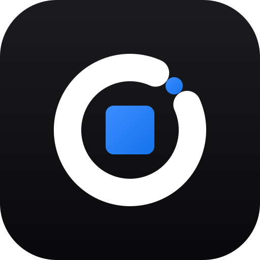

<p align="center">
  
</p>

<h1 align="center">Reboxed</h1>

<p align="center">
  <b>Le logiciel DJ, en mieux.</b><br>
  <sub>Le logiciel DJ gratuit, libre et ouvert pour Windows.</sub>
</p>

<p align="center">
  <a href="https://github.com/Vlocky1/Reboxed/releases"></a>
  <a href="LICENSE"></a>
  
  
  
</p>

<p align="center">
  <a href="#-installer">Installer</a> ·
  <a href="#-pourquoi-reboxed-">Pourquoi Reboxed</a> ·
  <a href="#-fonctionnalités">Fonctionnalités</a> ·
  <a href="docs/PLUGINS.md">Plugins</a> ·
  <a href="docs/DDJ-GRV6.md">DDJ-GRV6</a>
</p>

<p align="center">
  Bibliothèque · 4 decks · Stems par IA · Groove Circuit · Contrôleurs Pioneer par plugins ·
  Téléchargement YouTube / SoundCloud · Tags automatiques Deezer / Spotify ·
  Export clé USB pour lecteurs DJ · Import de ta collection (XML)
</p>

---

## ✨ Pourquoi Reboxed ?

Reboxed reprend le flux de travail que les DJ connaissent déjà (mode PERFORMANCE, CUE façon platine de club, hot cues, export sur clé USB). Il corrige aussi ce qui frustre au quotidien dans les logiciels DJ classiques.

### 🔓 1. Open source, gratuit, sans abonnement
Le code est **entièrement ouvert** et distribué sous **licence MIT**. Toutes les fonctions sont incluses, sans formule payante ni matériel à « débloquer ».
Tu peux lire le code, le modifier, corriger un bug, ajouter ton contrôleur et partager ton travail avec les autres.

### ⬇️ 2. Télécharge tes morceaux directement dans le logiciel
Un bouton **DOWNLOAD** te permet de chercher sur **YouTube** ou **SoundCloud**, de coller un lien (morceau, playlist, page d'artiste) et de suivre les nouveautés de tes chaînes préférées.
Les fichiers arrivent en M4A, MP3 320, FLAC ou WAV, avec des tags propres et la pochette intégrée. Ils sont ajoutés tout de suite à ta collection. Tu n'as plus besoin de jongler entre un navigateur, un convertisseur et l'import.

### 🏷️ 3. Des infos de morceaux remplies automatiquement par API
Avec **Deezer** (sans compte) et **Spotify** (facultatif), Reboxed retrouve le titre, l'artiste, l'album, le **genre**, le **label**, l'année et la pochette.
Tu peux le faire morceau par morceau ou **en masse** avec une recette d'étapes. Les titres de vidéos « Artiste - Titre (Clip officiel) [HD] » sont nettoyés. Un résultat n'est retenu que si l'artiste, le titre et la durée concordent. Tu valides chaque changement avant qu'il soit enregistré, et tout peut être annulé.

### 🗂️ 4. Une bibliothèque qui t'appartient vraiment
Beaucoup de logiciels DJ rangent toute ta collection dans une **base de données chiffrée**. Tu ne peux ni la lire, ni la réparer, ni l'automatiser, ni la sauvegarder intelligemment sans passer par le logiciel ou un export XML.

Reboxed refond complètement la gestion des collections et des playlists :

- **Format ouvert et lisible** : ta bibliothèque est un simple `library.json`, accompagné des dossiers `analysis\`, `artwork\` et `stems\`. Aucun chiffrement, aucune boîte noire.
- **Sauvegarde triviale** : copier le dossier suffit. Tu peux aussi le synchroniser ou le versionner.
- **Bibliothèque nomade** : le dossier peut vivre sur une **clé USB**. Les chemins suivent même si la lettre du lecteur change d'un PC à l'autre.
- **Playlists repensées** : dossiers, Intelligent Playlists (conditions ET/OU), Tag List, historiques modifiables (une mini-playlist par jour), My Tag et couleurs.
- **Aucun enfermement** : import fidèle d'une collection exportée en XML, sans doublons, et export en XML, M3U8 ou **clé USB pour lecteurs DJ**.

### Ce que Reboxed change, en un coup d'œil

| | Logiciels DJ classiques | **Reboxed** |
|---|---|---|
| Code source | Fermé, propriétaire | ✅ **Ouvert, licence MIT** |
| Coût | Base gratuite, fonctions avancées via abonnement ou matériel | ✅ **Gratuit, tout inclus** |
| Base de données | Base chiffrée | ✅ **`library.json` lisible et portable** |
| Bibliothèque sur clé USB | Base liée à l'ordinateur | ✅ **Dossier complet sur USB, chemins qui suivent** |
| Téléchargement de morceaux | — | ✅ **YouTube et SoundCloud intégrés** |
| Tags en ligne (genre, label…) | — | ✅ **Deezer et Spotify, unitaire ou en masse** |
| Contrôleurs | Mappings fournis par le constructeur | ✅ **Plugins ouverts, créables depuis un `.midi.csv`** |
| Stems | Séparation en une seule qualité | ✅ **FAST progressif et HQ en arrière-plan, rangés en MP3** |
| Export sur clé USB pour lecteurs DJ | ✅ | ✅ `export.pdb`, ANLZ, My Settings |

---

## 📦 Installer

1. Télécharge `Reboxed-Setup-<version>.exe` dans les **[Releases](https://github.com/Vlocky1/Reboxed/releases)**.
2. Lance-le. Windows affiche « Éditeur inconnu », car l'installeur n'est pas signé : clique sur *Informations complémentaires*, puis sur *Exécuter quand même*.
3. Reboxed démarre en plein écran fenêtré (fenêtre agrandie). **F11** passe en vrai plein écran, et *Préférences ▸ General ▸ Window at start* change ce comportement.

> [!TIP]
> **Tu viens d'un autre logiciel DJ ?** Exporte ta collection en XML (`File ▸ Export Collection in xml format`). Dans Reboxed, ouvre le menu **⋯ ▸ *Import a DJ library (XML)*** ou fais simplement glisser le fichier `.xml` sur la fenêtre.
> Tes hot cues, memory cues, boucles, grilles, playlists et dossiers sont repris.

---

## 🎛️ Fonctionnalités

```sh
npm install
npm start          # lance l'application
npm test           # 94 tests unitaires (recherche, DSP, grilles, phrases, Camelot, import XML, listes, MIDI, contrôleurs, plugins, export clé USB, formes d'onde, stockage…)
npm run shots      # captures de toutes les fonctionnalités (docs/screenshots), sur une bibliothèque de démo générée
                   # (avec REBOXED_DEMO_SONG="chemin|Titre|Artiste" : stems HQ d'un vrai morceau, exportés pour le site)
npm run smoke      # test de bout en bout dans Electron, sans toucher à ta bibliothèque
                   # (avec REBOXED_SPLEETER_DIR=<dossier des 4 .fp16.onnx> et/ou REBOXED_STEM_MODEL=<HT-Demucs .onnx>, il teste aussi les stems FAST/HQ ;
                   #  avec REBOXED_DL_TEST=1, il fait une vraie recherche et un vrai téléchargement YouTube)
```

- Import par dossier, par fichiers ou par **glisser-déposer**.
- Collection, playlists et dossiers, **Intelligent Playlists** (conditions ET/OU), Tag List et Related Tracks.
- **Historiques** : une mini-playlist par jour. Tu peux en retirer des morceaux, supprimer un jour ou tout effacer.
- Notes, 8 couleurs, **My Tag** et détection des fichiers manquants.
- **Colonnes** au choix (clic droit sur l'en-tête) et **redimensionnables** :
  - glisser le bord pour changer la largeur ;
  - double-cliquer pour ajuster au contenu ;
  - « Fit all columns » pour tout ajuster d'un coup.

  Les largeurs sont mémorisées.
- La colonne **Date Added** affiche aussi l'heure pour les morceaux ajoutés depuis la 1.5.

<details>
<summary><b>📝 Track information</b> : fiche complète et modifiable (clic droit)</summary>

Chaque champ est modifiable et accompagné d'une aide. La fiche est organisée en sections :

- **Track** ;
- **Credits** ;
- **DJ** : note, couleur, My Tag, commentaires, BPM, tonalité, nombre de lectures, date et heure d'ajout ;
- **File** : en lecture seule.

</details>

### 🏷️ Infos des morceaux par API (Deezer / Spotify)

Le bouton **Search info (Deezer / Spotify)** de la fiche Track information te laisse choisir le service, et ce choix est mémorisé.

| Service | Compte | Ce qu'il apporte |
|---|---|---|
| **Deezer** | Aucun | Genres et labels |
| **Spotify** | Identifiants gratuits | Titres et artistes propres. Spotify n'a presque plus de genres, donc Reboxed reprend le genre et le label du **même morceau sur Deezer** (même ISRC, ou même artiste et titre). |

Pour chaque champ, Reboxed montre côte à côte la **valeur actuelle** et la **valeur trouvée** : titre, mix, artiste, album, genre, année, numéro de piste, label, pochette… Il ne remplace que les cases cochées.
- Le genre est coché d'office.
- S'il y a plusieurs genres, tu choisis lequel garder.

Une recherche qui ne répond pas s'arrête au bout de 15 s avec un message clair.

<details>
<summary><b>⚡ Auto-tag en masse</b></summary>

Tu peux lancer l'auto-tag de deux façons :
- clic droit sur une sélection ▸ *Auto-tag with Spotify / Deezer…* ;
- menu **⋯** pour traiter toute la liste affichée.

**Une recette d'étapes**, chacune avec son service et ses champs. Par exemple :
1. **Spotify** : titre et artistes ;
2. **Deezer** : genre, cherché avec le titre que Spotify vient de nettoyer.

**Une recherche fiable :**
- Les titres de vidéos (« Artiste - Titre (Clip officiel) [HD] ») sont nettoyés avant la recherche.
- Un résultat n'est retenu que si l'artiste, le titre **et** la durée correspondent (± 4 s, réglable).
- La bonne version (Extended, Radio Edit…) est préférée.

**Options par étape :** ne remplir que les champs vides, ajouter le nom du mix dans le titre.

**Un contrôle total :**
- Tous les changements s'affichent avant d'être enregistrés.
- Ils sont cochés d'office, et tu peux les décocher un par un ou champ par champ.
- *Apply* enregistre, *Undo* revient en arrière.
- La recette est mémorisée.

</details>

<details>
<summary><b>🔑 Ajouter Spotify (facultatif)</b></summary>

1. Crée une appli Spotify gratuite sur [developer.spotify.com/dashboard](https://developer.spotify.com/dashboard), avec ces réglages :
   - **Redirect URI** : `http://127.0.0.1:8888/callback`. Elle n'est jamais utilisée, mais Spotify l'exige.
   - **API** : Web API.
2. Colle le **Client ID** et le **Client Secret** dans *Préférences ▸ Library*.

</details>

### 🔎 Recherche

- Un moteur de recherche instantané, insensible aux accents et à la casse.
- **Track Filter** : BPM ±%, Key, Rating, Color et My Tag.

### ⬇️ Téléchargement

Le bouton **DOWNLOAD** de la barre du haut ouvre trois onglets.

| Onglet | Rôle |
|---|---|
| **Search** | Tu choisis **YouTube** ou **SoundCloud** (le choix est mémorisé), puis tu cherches. |
| **Link** | Tu colles un lien. Reboxed reconnaît tout seul la plateforme et le type de lien (vidéo, morceau, playlist, page d'artiste) et refuse les autres sites. |
| **New releases** | Nouveautés des chaînes YouTube ou SoundCloud que tu suis, vérifiées au démarrage. |

- **Formats** : M4A, MP3 320, FLAC ou WAV, à régler dans *Préférences ▸ Downloads*.
- **Tags** « Artiste - Titre » nettoyés et **pochette intégrée**.
- Les morceaux arrivent dans la collection **et** dans la playlist « Downloads ».
- Les morceaux SoundCloud réservés aux abonnés Go+ ne donnent qu'un extrait de 30 s. Ils sont signalés « 30 s preview ».
- **Moteur** : yt-dlp, ffmpeg et deno. S'il en manque, le bouton **Install** (fenêtre de téléchargement ou Préférences ▸ Downloads) les télécharge depuis leurs sources officielles dans le dossier `tools` de Reboxed, et **Update yt-dlp** met yt-dlp à jour. Sinon, Reboxed les cherche dans un dossier choisi dans les Préférences, dans l'installation de Stacher si elle existe, ou dans le PATH.

> [!NOTE]
> Télécharge uniquement des contenus que tu as le droit d'utiliser, et respecte les droits d'auteur ainsi que les conditions des plateformes.

### 🔁 Import et export XML

L'outil **Import a DJ library (XML)** est accessible depuis le menu ⋯ du navigateur, ou en glissant un fichier `.xml` sur la fenêtre.

- **Ce qu'il importe** : toutes les infos des morceaux, les hot cues, les memory cues, les boucles, les grilles, les playlists et les dossiers.
- **Aperçu chiffré** avant l'import, avec le choix des playlists à reprendre.
- **Réglages de fusion** :
  - pour les infos, *le XML gagne* ou *garder mes modifs* ;
  - pour les cues, *remplacées*, *fusionnées* ou *gardées*.
- **Fichiers déplacés** retrouvés automatiquement, et **réimport sans doublons**.
- **Export** en XML et en M3U8.

### 💾 Bibliothèque amovible

Dans *Préférences ▸ Library*, le **dossier de la bibliothèque** peut être placé sur une clé USB.

- Si la lettre de la clé change d'un PC à l'autre, les chemins suivent.
- Si la clé est absente au démarrage, Reboxed propose de réessayer, de choisir un autre dossier ou d'utiliser la bibliothèque locale.
- Les **stems** vont par défaut dans `<bibliothèque>\stems`. Tu peux les déplacer vers un autre dossier ou les ranger à côté de chaque morceau.

<details>
<summary><b>🚚 Move my collection to a USB drive</b></summary>

Cet outil se trouve dans *Préférences ▸ Library* ou dans le menu ⋯.

**Comment Reboxed trouve les morceaux.** Pour chaque morceau encore sur l'ordinateur, il cherche son homonyme dans le dossier de la clé que tu choisis. Rien n'est proposé d'office. Il le reconnaît s'il porte :
- le même nom ;
- le même nom dans un autre format ;
- ou un nom proche, confirmé par les tags et par la durée à ±2 s.

Un Extended Mix n'est pas confondu avec l'Original Mix.

**Les cas douteux** sont vérifiés morceau par morceau. Pour chacun, tu peux le lier, le copier sur la clé (dossier `From computer`), le garder ou le retirer.

**Ce qui est conservé :**
- les cues, tags, analyses et playlists ;
- les stems, qui suivent dans le dossier `stems` de la clé.

Les morceaux présents seulement sur la clé sont ajoutés. Les fichiers locaux peuvent partir à la corbeille.

</details>

### 💿 Export sur clé USB pour lecteurs DJ

Le menu ⋯ ▸ *Export to USB for DJ players…* écrit une clé lisible par les lecteurs de club.

- **`export.pdb`** : morceaux, artistes, albums, genres, tonalités, couleurs, pochettes, playlists et dossiers. Les listes intelligentes y sont figées.
- **Fichiers d'analyse `ANLZ0000.DAT/.EXT/.2EX`** :
  - grille ;
  - hot cues **avec leur couleur** et leur nom ;
  - memory cues et boucles ;
  - formes d'onde bleue, RGB et 3Band.
- **My Settings** des lecteurs et de la table de mixage : couleur de forme d'onde, format de tonalité, position de lecture, luminosité, jog, quantize, Auto Cue, tempo, courbes de fader…
- **Que copier** : toute la collection ou seulement des playlists. Les morceaux déjà sur la clé restent en place, les autres sont copiés dans `Contents`.
- Un export existant est d'abord **sauvegardé**.

> [!IMPORTANT]
> L'export a été vérifié avec des lecteurs indépendants du format, mais **pas encore essayé sur un vrai lecteur**. Les retours sont les bienvenus !

### 📈 Analyse

- **BPM** et grille constante ou dynamique, avec le premier temps de mesure.
- **Tonalité** en Camelot ou en notation classique.
- **Phrases** : INTRO, UP, CHORUS, DOWN, OUTRO…
- **Formes d'onde** 3Band, RGB et BLUE :
  - zoomée, c'est la vraie onde, précise au 1/2700ᵉ de seconde ;
  - dézoomée, c'est une vue simplifiée.
- **Loudness** et **empreinte audio**.

### 🧬 Stems par IA

Reboxed sépare chaque morceau en **VOCAL / INST / BASS / DRUMS**, en deux qualités.

| Qualité | Moteur | Comportement |
|---|---|---|
| **FAST** | Spleeter, environ 7× le temps réel | **Progressif** : la séparation commence à la tête de lecture, et le deck utilise les stems dès que le premier bloc est prêt. |
| **HQ** | HT-Demucs | Prend le relais en arrière-plan en mode *auto*. |

- **Avancement visible partout** : pastille de la barre du haut, bouton STEMS, barre de couverture de la vue d'ensemble et colonne « Stems ».
- La forme d'onde est **colorée par stem**. Coupure et solo sont disponibles par deck.
- **Stockage léger** : les stems sont rangés en MP3 (256 ou 320 kbps) ou en WAV, au choix. En MP3, un stem de 5 min pèse environ 9 Mo, contre 53 Mo en WAV. Un bouton convertit les anciens stems WAV.

### 🛠️ Préparation

- Éditeur de grille (tap tempo, verrouillage…).
- Cues créés depuis les phrases.
- MIX IN / MIX OUT et **Mix Point Link**.
- **Track Suggestion** : propose des morceaux qui sonnent pareil.

### 🎚️ Performance

| Zone | Fonctionnalités |
|---|---|
| **Bibliothèque** | Import par dossier, fichiers ou glisser-déposer. Collection, playlists et dossiers. Intelligent Playlists (conditions ET/OU). Tag List, Related Tracks, historiques (une mini playlist par jour ; on peut en retirer des morceaux, supprimer un jour ou tout effacer), notes, 8 couleurs, My Tag, détection des fichiers manquants. **Track information** (clic droit) : chaque champ modifiable, avec une aide, en sections Track, Credits, DJ (note, couleur, My Tag, commentaires, BPM, tonalité, nombre de lectures, date et heure d'ajout) et File en lecture seule. Bouton **Search info (Deezer / Spotify)** : tu choisis le service (le choix est mémorisé). **Deezer** marche sans compte et donne les genres et les labels ; **Spotify** demande ses identifiants, et comme il n'a presque plus de genres, un résultat Spotify reprend le genre et le label du même morceau sur Deezer (même ISRC, ou même artiste et titre). Une recherche qui ne répond pas s'arrête au bout de 15 s avec un message clair ; Reboxed montre pour chaque champ la valeur actuelle et celle trouvée (titre, mix, artiste, album, genre, année, numéro de piste, label, pochette…) et ne remplace que les cases cochées (le genre est coché d'office ; s'il y a plusieurs genres, tu choisis lequel). Pour ajouter Spotify (facultatif) : une appli Spotify gratuite créée sur developer.spotify.com/dashboard (redirect URI : `http://127.0.0.1:8888/callback`, jamais utilisée mais exigée par Spotify ; API : Web API), dont on colle le Client ID et le Client Secret dans Préférences ▸ Library. **Auto-tag en masse** (clic droit sur une sélection ▸ *Auto-tag with Spotify / Deezer…*, ou menu ⋯ pour la liste affichée) : une recette d'étapes, chacune avec son service et ses champs, par exemple 1) Spotify : titre et artistes, puis 2) Deezer : genre, cherché avec le titre que Spotify vient de nettoyer. Les titres de vidéos (« Artiste - Titre (Clip officiel) [HD] ») sont nettoyés avant la recherche. Un résultat n'est retenu que si l'artiste, le titre et la durée (± 4 s, réglable) correspondent, et la bonne version (Extended, Radio Edit…) est préférée. Options par étape : ne remplir que les champs vides, nom du mix dans le titre. Tous les changements s'affichent avant d'être enregistrés, cochés d'office et décochables un par un ou par champ ; *Apply* enregistre, *Undo* revient en arrière. La recette est mémorisée. La colonne **Date Added** affiche aussi l'heure pour les morceaux ajoutés depuis la 1.5. **Colonnes** au choix (clic droit sur l'en-tête) et **redimensionnables** : glisser le bord, double-clic pour ajuster au contenu, « Fit all columns » dans le menu ; les largeurs sont mémorisées. |
| **Recherche** | Moteur instantané, insensible aux accents, et Track Filter (BPM ±%, Key, Rating, Color, My Tag). |
| **Import XML** | Outil **Import a DJ library (XML)** (menu ⋯ du navigateur, ou glisser un fichier `.xml` sur la fenêtre). Il importe toutes les infos des morceaux, les hot cues, les memory cues, les boucles, les grilles, les playlists et les dossiers. Il affiche un aperçu chiffré, permet de choisir les playlists et de régler la fusion (le XML gagne ou garder mes modifs ; cues remplacées, fusionnées ou gardées), retrouve les fichiers déplacés et peut réimporter sans doublons. Export XML et M3U8. |
| **Téléchargement** | Bouton **DOWNLOAD**. Onglet **Search** : tu choisis la plateforme, **YouTube** ou **SoundCloud** (le choix est mémorisé), puis tu cherches. Onglet **Link** : tu colles un lien, Reboxed reconnaît tout seul s'il vient de YouTube ou de SoundCloud (vidéo, morceau, playlist, page d'artiste) et refuse les autres sites. Les morceaux SoundCloud réservés aux abonnés Go+ ne donnent qu'un extrait de 30 s : ils sont signalés « 30 s preview ». Onglet **New releases** : nouveautés des chaînes suivies (YouTube ou SoundCloud ; vérifiées au démarrage). Formats M4A, MP3 320, FLAC ou WAV, réglés dans Préférences ▸ Downloads. Pochette intégrée. **Nettoyeur de noms** : à l'ajout dans la collection, les titres et artistes perdent « (Paroles) », « [Official Video] », « | Lyrics », « Visualizer », « Clip officiel », « HD », les hashtags, « - Topic », « VEVO »… ; « Artiste - Titre » est séparé quand l'artiste n'est que la chaîne. Les mix, remix, edits, feat. et versions live restent. La liste de mots est modifiable (Préférences ▸ Downloads, avec un essai en direct), et le nettoyeur s'applique aussi aux morceaux déjà présents (clic droit ▸ *Clean names*, avec aperçu et annulation). Les morceaux arrivent dans la collection et dans la playlist « Downloads ». Le moteur est yt-dlp + ffmpeg + deno, trouvés dans le PATH, dans un dossier choisi dans les Préférences ou dans l'installation de Stacher si elle existe. |
| **Bibliothèque amovible** | Préférences ▸ Library : le **dossier de la bibliothèque** peut être sur une clé USB. Si la lettre de la clé change d'un PC à l'autre, les chemins suivent ; si la clé est absente au démarrage, Reboxed propose Réessayer, un autre dossier ou la bibliothèque locale. Les **stems** vont par défaut dans `<bibliothèque>\stems`, déplaçables vers un autre dossier ou à côté de chaque morceau. **Move my collection to a USB drive** (Préférences ▸ Library ou menu ⋯) : pour chaque morceau encore sur l'ordinateur, Reboxed cherche son homonyme dans le dossier de la clé que tu choisis (rien n'est proposé d'office). Il le reconnaît s'il porte le même nom, le même nom dans un autre format, ou un nom proche confirmé par les tags et la durée à ±2 s ; un Extended Mix n'est pas confondu avec l'Original Mix. Tu vérifies les cas douteux morceau par morceau : lier, copier sur la clé (dossier `From computer`), garder ou retirer. Les cues, tags, analyses et playlists sont conservés, les stems suivent dans le dossier `stems` de la clé, les morceaux présents seulement sur la clé sont ajoutés, et les fichiers locaux peuvent partir à la corbeille. |
| **Export clé USB** | Menu ⋯ ▸ *Export to USB for DJ players…* : écrit une clé lisible par les lecteurs de club. Base `export.pdb` (morceaux, artistes, albums, genres, tonalités, couleurs, pochettes, playlists et dossiers ; listes intelligentes figées), fichiers d'analyse `ANLZ0000.DAT/.EXT/.2EX` (grille, hot cues **avec leur couleur** et leur nom, memory cues, boucles, formes d'onde bleue, RGB et 3Band) et **My Settings** des lecteurs et de la table de mixage (couleur de forme d'onde, format de tonalité, position de lecture, luminosité, jog, quantize, Auto Cue, tempo, courbes de fader…). Toute la collection ou seulement des playlists ; les morceaux déjà sur la clé restent en place, les autres sont copiés dans `Contents`. Un export existant est d'abord sauvegardé. Vérifié avec des lecteurs indépendants du format ; pas encore essayé sur un vrai lecteur. |
| **Analyse** | BPM et grille constante ou dynamique, premier temps de mesure, tonalité en Camelot ou classique, phrases (INTRO/UP/CHORUS/DOWN/OUTRO…), forme d'onde 3Band / RGB / BLUE (zoomée : la vraie onde, précise au 1/2700ᵉ de seconde ; dézoomée : vue simplifiée), loudness, empreinte audio. |
| **Stems** | VOCAL / INST / BASS / DRUMS par IA, en deux qualités. **FAST** (Spleeter, environ 7× le temps réel) est progressif : la séparation commence à la tête de lecture et le deck utilise les stems dès que le premier bloc est prêt. **HQ** (HT-Demucs) prend le relais en arrière-plan en mode *auto*. **Moteur** au choix (Préférences ▸ Stems) : CPU, ou GPU via **WebGPU** (Direct3D 12) ou **DirectML**. En *Auto*, le bouton *Test the engines* mesure chaque moteur sur l'ordinateur et Reboxed prend le plus rapide pour chaque modèle (un GPU intégré est souvent plus lent que le CPU, une vraie carte graphique bien plus rapide) ; un moteur qui plante repasse sur le CPU et n'est plus choisi. Avancement visible dans la pastille de la barre du haut, sur le bouton STEMS, sur la barre de couverture de la vue d'ensemble et dans la colonne « Stems ». La forme d'onde est colorée par stem. Coupure et solo par deck. **PART ISOLATOR** (bouton ISO de chaque tranche, ou celui de la platine) : les potards HI / MID / LOW deviennent VOCAL / INST + BASS / DRUMS. **Groove Circuit** : DRUM SWAP (2 banques de 4 cases ; menu *DRUMS…* pour choisir dans chaque case un motif intégré, un fichier audio ou une capture, son gain, éjecter), DRUM CAPTURE (CAPTURE puis la case : 4 à 32 temps de la batterie du morceau), DRUM ROLL (le coup capturé tourne tant qu'un bouton de roll est tenu), DRUM RELEASE FX (BACKSPIN, BRAKE, ROLL ECHO, ECHO, FILTER, ROLL : la batterie s'en va avec l'effet). Stems rangés en **MP3** (256 ou 320 kbps, environ 9 Mo par stem pour 5 min au lieu de 53 Mo en WAV) ou en WAV, au choix ; un bouton convertit les anciens stems WAV. |
| **Préparation** | Éditeur de grille (tap tempo, verrouillage…), cues créés depuis les phrases, MIX IN / MIX OUT et Mix Point Link, Track Suggestion (morceaux qui sonnent pareil). |
| **Decks** (2 ou 4) | **Jog** façon platine de club par deck : le plateau tourne à 33⅓ tours avec son trait indicateur, l'anneau montre la position dans le morceau (rouge clignotant dans les 30 dernières secondes) et le centre affiche le BPM, la variation de tempo et les calibres ±6 / ±10 / ±16 / WIDE (cliquables). On scratche en glissant sur le plateau, la molette fait un pitch bend, Maj + glisser (ou SHIFT + jog sur la platine) fait défiler vite et en continu. CUE façon platine de club, 16 hot cues (A–P), memory cues, boucles de 1/64 à 512 temps (les flèches de taille redimensionnent aussi la boucle en cours, depuis son début), beat jump, quantize, tempo ±6/10/16/WIDE, Master Tempo et Key Shift sans effet « robot » (time-stretch WSOLA), Key Sync, Slip, Reverse, Censor, Beat Sync ou BPM Sync, Instant Doubles, édition de grille. |
| **Pads** | Un menu déroulant : HOT CUE, PAD FX, SLICER, BEAT JUMP, BEAT LOOP, SAMPLER, KEYBOARD, KEY SHIFT, STEMS, MEMORY CUE (SEQ CALL : pas encore). Chaque page a sa barre sous les pads. Les valeurs des pads (BEAT JUMP −1/4 +1/4 −1/2 +1/2 −1 +1 −2 +2…, KEY SHIFT +4 +5 +6 +7 / 0 +1 +2 +3…) sont les valeurs standard, sur 2 pages, les mêmes à l'écran et sur la platine. Les boutons de mode de la platine ouvrent la page correspondante, et l'inverse. Avec Quantize, les boucles démarrent sur le temps le plus proche ; les beat jumps tombent exactement sur la grille. |
| **Mixer** | En 4 decks, ordre des voies 3-1-2-4 comme sur une table 4 voies. Trim, auto-gain, EQ isolateur 3 bandes ou PART ISOLATOR, Color FX (FILTER, SPACE, DUB ECHO, NOISE, CRUSH ; éteint au démarrage, avec FX PART SELECT il ne touche que les parties choisies), cue casque sur une 2ᵉ carte son, courbes de fader et de crossfader, limiteur, VU-mètres. |
| **Beat FX** (16) | DELAY, ECHO, PING PONG, REVERB, FLANGER, PHASER, FILTER, TRANS, ROLL, REV ROLL, VINYL BRAKE, PITCH, UP ECHO, DOWN ECHO, PAN, ROBOT. Synchronisés au BPM (1/16 à 32 temps), sur CH1–4 ou MASTER ; à fond, l'effet est pleinement présent. |
| **Sampler** | 16 slots en one-shot ou en boucle, synchro au master, glisser-déposer. **Un clic sur une case vide y met la boucle qui joue** (deck master d'abord ; depuis les pads SAMPLER d'un deck, la boucle de ce deck, dans ses cases à lui : decks 1 et 3 cases 1–8, decks 2 et 4 cases 9–16 ; sans boucle posée, la taille de boucle choisie à partir du temps le plus proche). Avec les stems, **seuls les stems audibles sont capturés** (batterie seule → le sample n'a que la batterie). Sur une case remplie : **enregistrer** en WAV, **éditer** (nom, découpe début / fin sur la forme d'onde avec écoute, one-shot ou boucle, sync, BPM, gain) et **éjecter**. |
| **Automix** | Joue la liste affichée avec préchargement, sync et fondu de 4 à 32 temps ; répétition et lecture aléatoire. |
| **Enregistrement** | WAV 16 bits dans `Musique\Reboxed Recordings\`, ajouté automatiquement à la collection. |
| **Contrôle** | **Plugins matériels** (Préférences ▸ Plugins) : un plugin par contrôleur, activable ou non, reconnu automatiquement au branchement. Fournis : **DDJ-GRV6** (mapping complet, LED, jogs, Groove Circuit, carte son 4 canaux, [notice](docs/DDJ-GRV6.md)), **DDJ-FLX2**, **DDJ-FLX4**, **DDJ-FLX6** et **DDJ-FLX10** (générés depuis les mappings MIDI des constructeurs, chaque commande gérée et vérifiée par un test, comportement aligné sur le GRV6 : SHIFT + jog, CALL sur les boucles, pads ; pas encore essayés sur le matériel). N'importe qui peut en créer un pour un autre contrôleur, en un clic depuis un mapping `.midi.csv` ou à la main ([guide](docs/PLUGINS.md)), et le partager. Sans plugin, un contrôleur dont le mapping MIDI est installé sur l'ordinateur est quand même reconnu. **Clavier** : preset « Performance 1 », en QWERTY ou en AZERTY (clavier AZERTY détecté tout seul) ; chaque raccourci se change dans Préférences ▸ Keyboard (clic, puis la nouvelle touche), avec les lettres de ton clavier. MIDI learn. |

Disposition de l'interface :
- **Barre globale**, rangée par usage : logo, mode et dispositions (2 decks / 4 decks / navigateur) ; **panneaux** (FX, MIXER, SAMPLER) ; **aides au mix** (MIX POINT LINK, AUTOMIX) ; **outils** (DOWNLOAD, REC) ; puis l'état (stems, MIDI, horloge), le raccourci **Appearance** (palette) et les Préférences.
- **Thèmes** (Préférences ▸ Appearance) : Reboxed Dark, OLED Black, Midnight, Graphite, Ember, Neon, Forest et Rosé, avec un aperçu de chacun ; couleur d'accent au choix (10 teintes ou n'importe quelle couleur) ; taille de l'interface de 85 % à 125 % ; barre du haut avec icônes et noms ou icônes seules.
- **Mises à jour depuis l'appli** : au démarrage, Reboxed regarde sur GitHub si une version plus récente existe ; un bouton « Update » apparaît dans la barre du haut, et un clic télécharge, installe et relance la nouvelle version (bibliothèque conservée). Aussi dans Préférences ▸ General ▸ Updates.
- **Préférences épurées** (taille fixe, bouton de fermeture en haut à droite) : une barre latérale avec icônes, un titre et une phrase par section, des réglages en cartes, des interrupteurs à la place des cases à cocher. Onglets General, Appearance, Decks & Mixer, Audio, Library, Stems, Downloads, MIDI, Plugins, Keyboard. La version de Reboxed est affichée dans la barre de titre et en tête des Préférences.
- **Panneau Beat FX** sur sa propre ligne.
- **Formes d'onde agrandies** et empilées, avec le repère de chaque deck.
- **Decks** : pochette, bouton KEY (décalage en demi-tons), BPM, MASTER / BEAT SYNC / KEY SYNC, vue d'ensemble, gros CUE/PLAY, pads colorés, fader de tempo (sur un deck synchronisé, il déplace le tempo commun).
- **Mixer** : potards à arc de valeur, VU-mètres segmentés.
- **Navigateur** : icônes, recherche, colonne pochette.

> Palette, icônes et dessins sont propres à Reboxed : aucun fichier visuel ni logo de Pioneer/AlphaTheta n'est utilisé.

---

## 📁 Où sont les données

Reboxed n'utilise **aucune base chiffrée**. Tout est rangé dans des dossiers et fichiers que tu peux ouvrir, sauvegarder et déplacer.

**`%APPDATA%\Reboxed\`** (propre à l'ordinateur) contient :
- `location.json` : indique où se trouve la bibliothèque ;
- `models\` : les modèles de stems, `spleeter\` pour FAST et `htdemucs_fp16weights.onnx` pour HQ ;
- `plugins\` : les plugins matériels que tu as installés ou créés ;
- les caches.

Les versions précédentes utilisaient `%APPDATA%\rbclone\`. Ce dossier est renommé automatiquement au premier lancement.

**Le dossier de la bibliothèque** est par défaut le même. Il peut aussi être sur une clé USB. Il contient :

| Élément | Contenu |
|---|---|
| `library.json` | Collection, playlists, dossiers, cues, tags… au format JSON lisible |
| `analysis\` | Grilles, formes d'onde, phrases |
| `artwork\` | Pochettes |
| `groove\` | Captures DRUM CAPTURE |
| `stems\<morceau>\` | `vocals`, `drums`, `bass`, `other` en `.mp3` (ou `.wav`) ; la version HQ remplace la FAST |

**Les stems** peuvent être rangés dans le dossier de la bibliothèque, dans un dossier au choix ou à côté de chaque morceau. Ceux déjà rangés à côté de la musique ou dans l'ancien cache restent lus.

> [!NOTE]
> La désinstallation **ne supprime pas** tes données.

---

## 👩‍💻 Développer

Reboxed est un logiciel desktop (**Electron + Web Audio**) qui reprend les fonctionnalités des logiciels DJ professionnels. Elles sont **réimplémentées** : aucun code, visuel ni asset de Pioneer/AlphaTheta n'est utilisé.

```sh
npm install
npm start          # lance l'application
npm test           # 94 tests unitaires (recherche, DSP, grilles, phrases, Camelot, import XML, listes,
                   # MIDI, contrôleurs, plugins, export clé USB, formes d'onde, stockage…)
npm run smoke      # test de bout en bout dans Electron, sans toucher à ta bibliothèque
```

<details>
<summary>Options du test <code>smoke</code></summary>

| Variable | Effet |
|---|---|
| `REBOXED_SPLEETER_DIR=<dossier des 4 .fp16.onnx>` | Teste aussi les stems FAST |
| `REBOXED_STEM_MODEL=<HT-Demucs .onnx>` | Teste aussi les stems HQ |
| `REBOXED_DL_TEST=1` | Fait une vraie recherche et un vrai téléchargement YouTube |

</details>

### Construire l'installeur Windows

```sh
npm run icon       # (re)génère build/icon.ico et build/icon.png
npm run dist       # dist/Reboxed-Setup-<version>.exe : installeur, avec choix du dossier et raccourcis Bureau / menu Démarrer
npm run dist:dir   # dist/win-unpacked/Reboxed.exe : version portable, sans installation
```

- **Tester la version empaquetée** : `dist\win-unpacked\Reboxed.exe --smoke "--shot=<png>"`.
- **Avertissement Windows** : l'installeur n'est pas signé, donc SmartScreen affiche « Éditeur inconnu ». Clique sur *Informations complémentaires*, puis sur *Exécuter quand même*.

### Architecture

```
src/main/        process Electron : fenêtre, protocoles app:// et media://, IPC, tags, stockage,
                 enregistrement WAV, plugins, export clé USB, stems (process isolé, encodage MP3)
src/plugins/     plugins matériels fournis (un dossier par contrôleur : plugin.json + mapping)
src/renderer/
  audio/         deck-processor (lecture, boucles, slip, time-stretch), fx-processor (roll, brake, pitch),
                 recorder-processor, deck, engine (mixer, Color FX), fx (Beat FX), sampler
  analysis/      décodage, ré-échantillonnage, worker
  ui/            decks et pads, mixer, navigateur, listes intelligentes et related, sampler, MIDI, préférences
  automix.js, library.js, app.js
src/shared/      code pur testé sous Node : DSP, Camelot, XML, import XML, smartlist, related, MIDI,
                 WAV, MP3, format des clés USB (export.pdb, ANLZ, My Settings), boucles DRUM SWAP,
                 chemins portables, liaison USB, date d'ajout
src/search/      moteur de recherche
```

### Contribuer

Reboxed est open source : les issues, les idées et les pull requests sont les bienvenues.
Tu peux par exemple :
- créer un plugin pour ton contrôleur ([guide](docs/PLUGINS.md)) ;
- tester l'export sur un vrai lecteur ;
- proposer une amélioration.

---

## 🗺️ Feuille de route

Prochaines étapes : mode Edit, Pad FX, vidéo…

---

## 📜 Licence

Reboxed est distribué sous **licence MIT** ([LICENSE](LICENSE)). Tout le monde peut l'utiliser, le copier, le modifier et le redistribuer, y compris pour un usage commercial. Seule condition : garder la mention de copyright et de licence.

<details>
<summary>Composants tiers</summary>

- **Electron**, **onnxruntime** et **music-metadata** : licence MIT.
- **lamejs** (`@breezystack/lamejs`, encodage MP3 des stems) : licence LGPL-3.0, utilisée sans modification comme bibliothèque séparée.
- **Modèles de stems**, téléchargés au premier usage et absents du dépôt :
  - Spleeter 4 stems : poids de Deezer sous MIT, export ONNX sous Apache-2.0 ;
  - HT-Demucs v4 : MIT.
- **yt-dlp**, **ffmpeg** et **deno** : ils ne sont pas fournis avec Reboxed. L'appli peut les télécharger à la demande depuis leurs releases officielles (yt-dlp, denoland/deno, yt-dlp/FFmpeg-Builds), ou utiliser ceux déjà installés.

</details>

<sub>Reboxed est un logiciel indépendant, ni affilié ni approuvé par AlphaTheta / Pioneer DJ. Les noms de contrôleurs (DDJ-GRV6, DDJ-FLX…) appartiennent à leurs propriétaires et ne sont cités que pour décrire la compatibilité.</sub>
